<a href="https://alexdev07.pages.dev">
  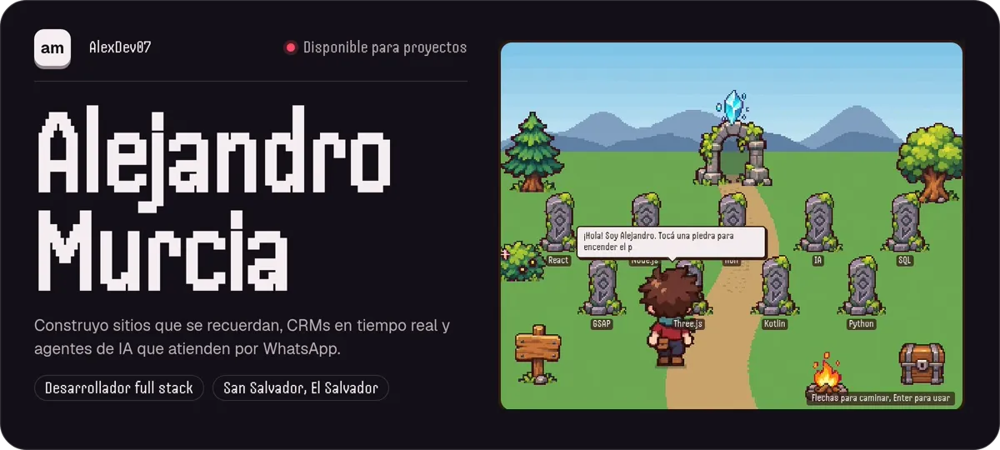
</a>

  <a href="https://alexdev07.pages.dev">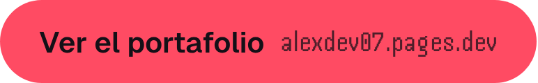</a>
  
  <a href="https://alexdev07.pages.dev/cv/CV_Hector_Murcia_ES.pdf">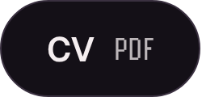</a>
  

 

<picture>
  <source media="(prefers-color-scheme: dark)" srcset="assets/t-trabajo-oscuro.png">
  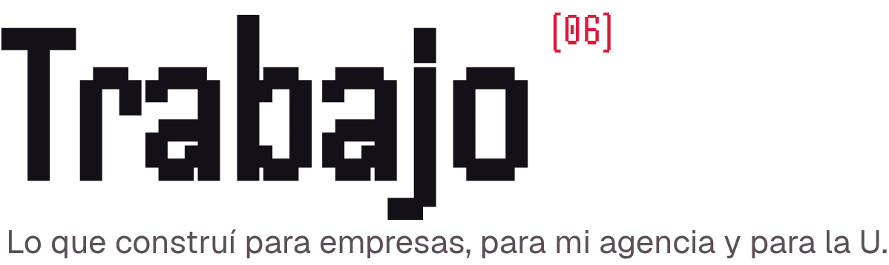
</picture>

  <a href="https://alexdev07.pages.dev/trabajo/vitanetrg/">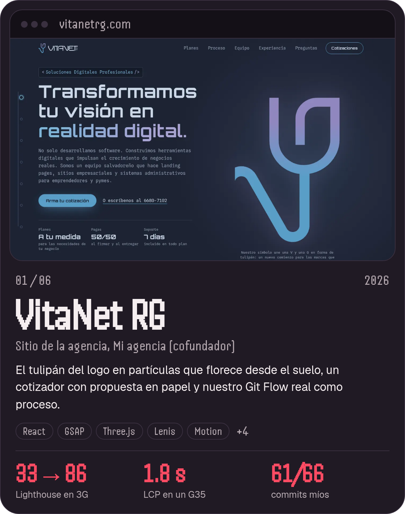</a>
  <a href="https://alexdev07.pages.dev/trabajo/conectau/">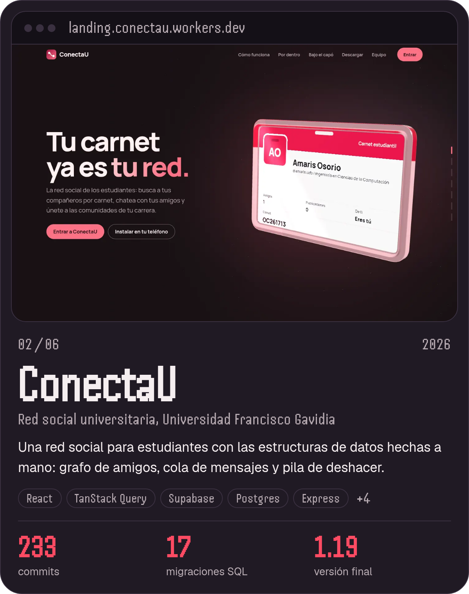</a>

  <a href="https://alexdev07.pages.dev/trabajo/turbochats/">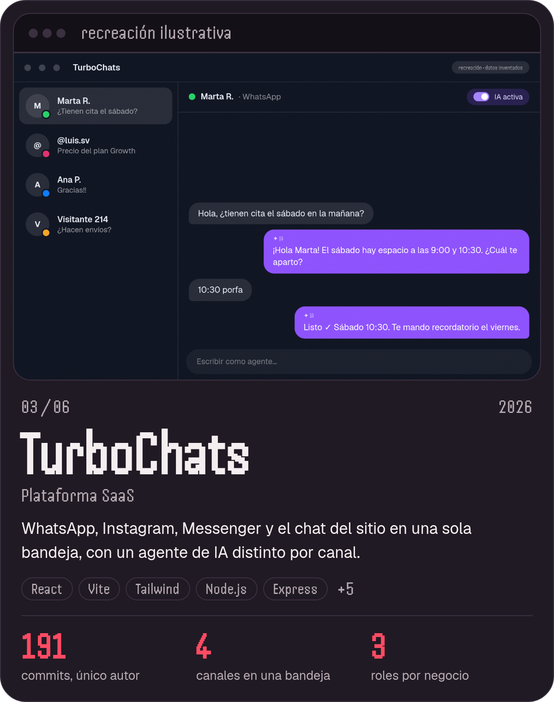</a>
  <a href="https://alexdev07.pages.dev/trabajo/appren-d/">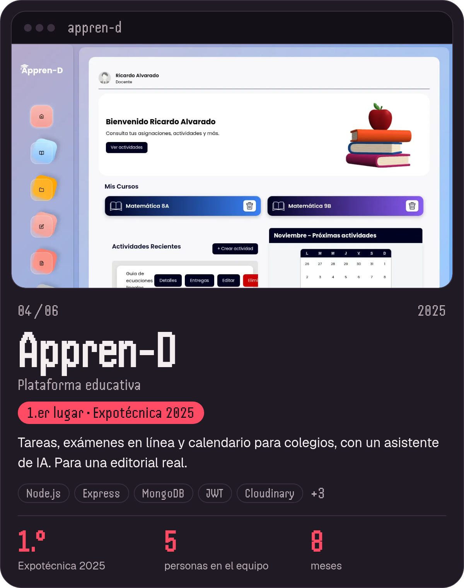</a>

  <a href="https://github.com/AlexGameDev07/wii-gamepad">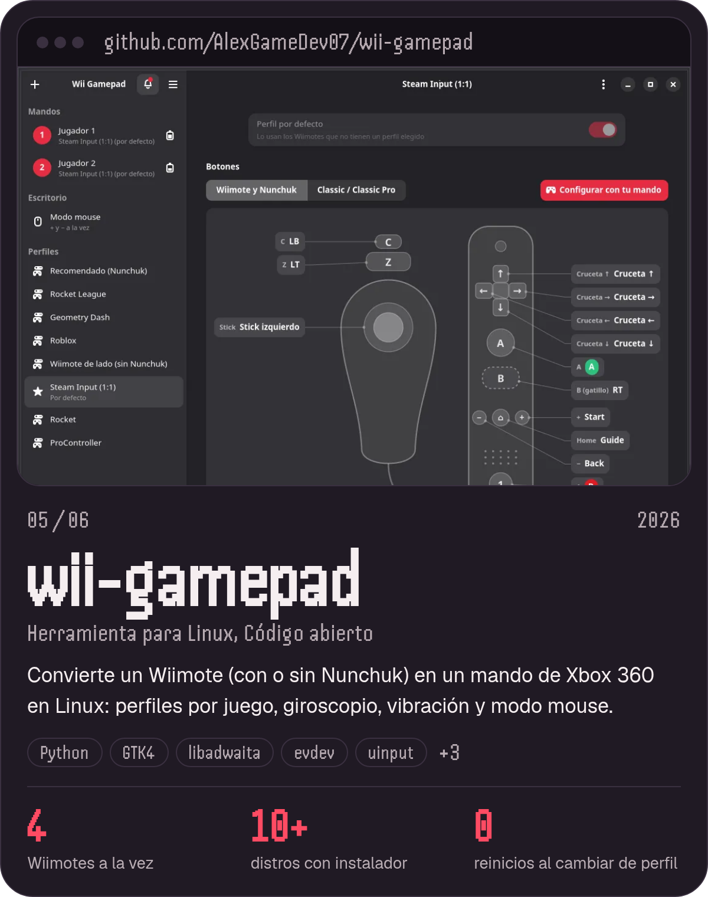</a>
  <a href="https://alexdev07.pages.dev/trabajo/deltamedic/">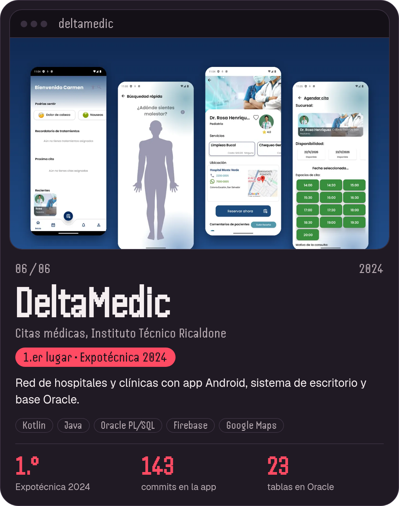</a>

<a href="https://alexdev07.pages.dev/#destacados">
  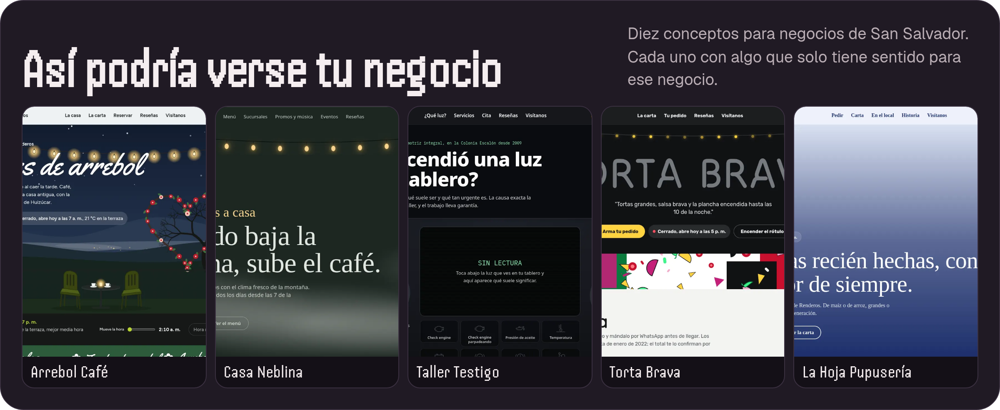
</a>

  

<picture>
  <source media="(prefers-color-scheme: dark)" srcset="assets/t-stack-oscuro.png">
  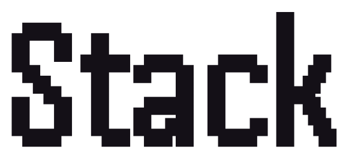
</picture>

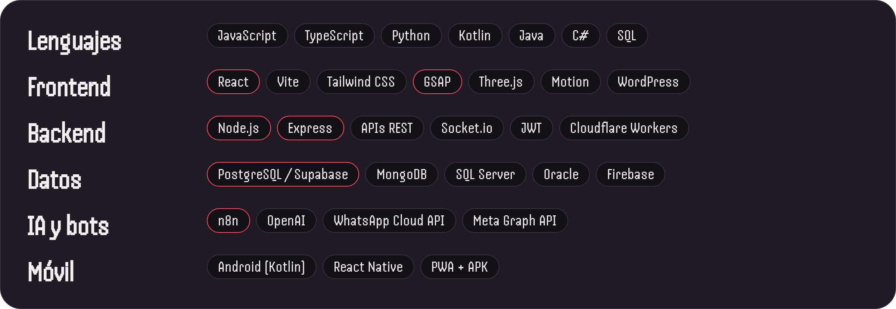

  

<picture>
  <source media="(prefers-color-scheme: dark)" srcset="assets/t-hablemos-oscuro.png">
  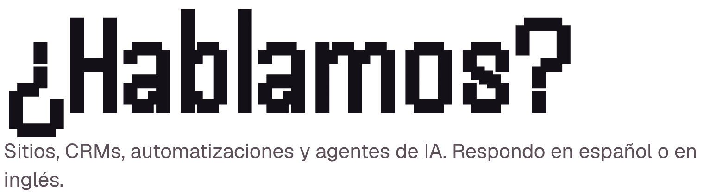
</picture>

  
  
  

Hecho pixel a pixel, igual que el portafolio. Las piezas se generan desde <code>fuente/</code> con <code>node fuente/render.mjs</code>.
